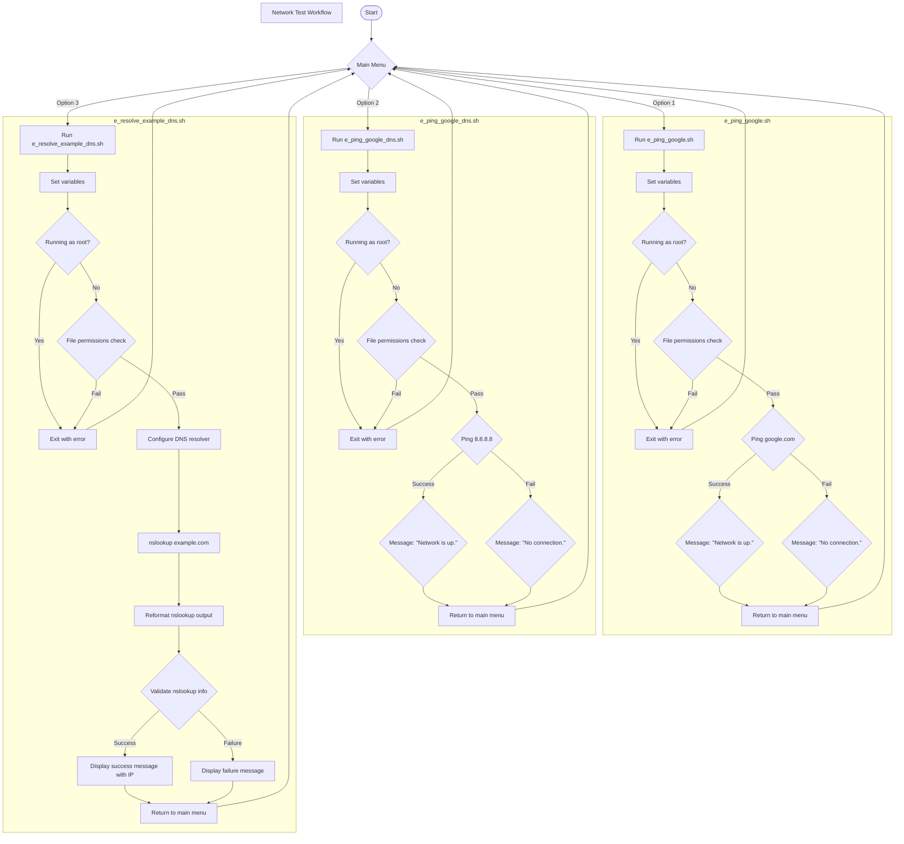

# Requirement E: Network Testing

This test suite consists of four scripts total:
* e_ping_google.sh - Pings google.com.
* e_ping_google_dns.sh - Pings Google's public DNS server (8.8.8.8).
* e_resolve_example_dns.sh - Resolves the DNS entry for example.com.
* menu.sh: Provides the user with a menu to seamlessly run each script.

## Compliance Considerations

The following controls are implemented across the four scripts used in this task:

| Control Name | Control Designator (NIST SP 800-53) | 800-171 Ref | Script |
|---|---|---|---|
| Least Privilege | AC-6 | 3.1.5 | __All__ |
| Event Logging / Content of Audit Records | AU-2 / AU-3 | 3.3.1 | __All__ |
| Time Stamps | AU-8 | 3.3.7 | __All__ |
| Audit Record Generation | AU-12 | 3.3.1 | __All__ |
| Access Restrictions for Change | CM-5 | 3.4.5 | __All__ |
| Least Functionality | CM-7 | 3.4.6 | __e_ping_google_dns.sh__ |
| Boundary Protection | SC-7 | 3.13.1 | __e_ping_google_dns.sh__ |
| Secure Name/Address Resolution Service | SC-20 / SC-21 / SC-22 | n/a | __e_resolve_example_dns.sh__ |
| System Monitoring | SI-4 | 3.14.6 | __e_ping_google.sh__, __e_ping_google_dns.sh__, __e_resolve_example_dns.sh__ |
| Software, Firmware, and Information Integrity | SI-7 | n/a | __All__ |
| Information Input Validation | SI-10 | n/a | __e_resolve_example_dns.sh__, __e_menu.sh__ |
| Error Handling | SI-11 | n/a | __All__ |

# Requirement E1: Flowchart Diagram

